<a href="https://arhylsion.github.io/ghgraph/">
  <picture>
    <source media="(prefers-color-scheme: dark)" srcset="assets/ghgraph-hero-dark.svg">
    <source media="(prefers-color-scheme: light)" srcset="assets/ghgraph-hero-light.svg">
    
  </picture>
</a>
<br>

<!--START_SECTION:waka-->

```txt
Python                     63 hrs 57 mins        █████▜░░░░░░░░░░░░░░░░░░░   22.54 %
PHP                        27 hrs 29 mins        ██▚░░░░░░░░░░░░░░░░░░░░░░   09.69 %
Astro                      25 hrs 30 mins        ██▖░░░░░░░░░░░░░░░░░░░░░░   08.99 %
TypeScript                 25 hrs 11 mins        ██▖░░░░░░░░░░░░░░░░░░░░░░   08.88 %
Markdown                   21 hrs 59 mins        ██░░░░░░░░░░░░░░░░░░░░░░░   07.75 %
```

<!--END_SECTION:waka-->

<a href="https://arhylsion.github.io/ghgraph/">
  <picture>
    <source media="(prefers-color-scheme: dark)" srcset="assets/ghgraph-dark.svg">
    <source media="(prefers-color-scheme: light)" srcset="assets/ghgraph-light.svg">
    
  </picture>
</a>

<br>

<a href="https://arhylsion.github.io/ghgraph/">
  <picture>
    <source media="(prefers-color-scheme: dark)" srcset="assets/ghgraph-stack-dark.svg">
    <source media="(prefers-color-scheme: light)" srcset="assets/ghgraph-stack-light.svg">
    
  </picture>
</a>
